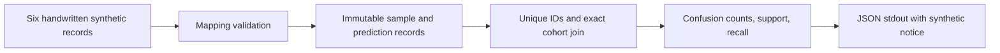

# Kiến trúc Foundation V1

## T3 synthetic provenance adapter — 01/11/2026

`evaluation/triage_adapter.py` nối fixture kết quả đã phân loại vào API T2:
manifest + content + ba reports + exact selection ledger + focal evidence
→ kiểm cohort/identity/SHA256/lineage + seal fixture cố định trong source
→ `AdaptedInputs(planned_ids, focal, peers, ...)` với kiểu T2 nguyên bản.
`VerifiedSource` giữ source identity, report/row hashes và missing IDs riêng;
input/evidence/manifest/selection/bundle hashes không tham gia ranking.

Không I/O, raw parser, quyền dữ liệu tự khai báo hoặc production switch.
Chỉ chín fixture viết tay được seal; thay nội dung dù tự tính lại checksum
vẫn bị từ chối. Report plan phải đồng nhất ba model; thiếu row giữ MISSING,
thiếu identity/report/selection thì dừng; không lựa chọn hoặc trộn attempts.
Peer HNLO bị cấm, focal VALID cần evidence fixture đúng mẫu/identity/input/
value; null/ineligible không impute, malformed bị từ chối.

Định tuyến: [hướng dẫn/hợp đồng T3](TRIAGE_ADAPTER.md), module trên,
`tests/test_triage_adapter.py`, `scripts/demo_triage_adapter_cpu.py` và T2 bên
dưới. Không cần đọc report/raw/ảnh/TEST thật. O2/O4/O5 vẫn PENDING/BLOCKED;
source seal chứng minh nội dung fixture, không khoa học/quyền/qualification.

## T2 CPU synthetic triage — 01/11/2026

`safeshift/evaluation/triage.py` cung cấp API không học, không I/O:

```python
from safeshift.evaluation.triage import build_review_queue

queue = build_review_queue(
    planned_ids, focal, peers, mode="combined", budget=K, tie_key=external_key,
)
```

`planned_ids` là iterable token opaque 32 ký tự hex thường, được cấp **trước**
predictions/GT và độc lập với nhãn, miền, filename. Không chuyển file stem thật
thành token bằng cách hash metadata chứa đáp án. Validation chỉ kiểm hình thức,
không chứng minh nguồn ID độc lập. Mapping ID→ảnh/GT thuộc custodian bên ngoài.
Không có GT/domain/path/raw payload trong hợp đồng đầu vào của bộ xếp hạng.

`focal` và từng phần tử `peers` là `ModelResults(identity, records)` bất biến.
`SourceIdentity(model_id, model_revision, implementation_id, configuration_id,
run_id, series_id, attempt_id)` giữ reference công khai của **một** nguồn đã chọn;
đây là lineage do caller cung cấp, không xác minh artifact hoặc cấp quyền chọn
series. Tối đa hai peers, các model ID phải khác nhau. Không tự gắn candidate
roster vào API hoặc pool attempts. Caller phải giữ effective MiniCPM identity
đúng quyết định khi một bước tích hợp thật được cấp quyền riêng.

`ClassifiedResult(sample_id, status, predicted_safety_level=None, hnlo=None)`
nhận SUCCESS + một nhãn canonical, hoặc INVALID/TECHNICAL_ERROR/NOT_ATTEMPTED
với nhãn null. ID vắng trong stream tạo MISSING riêng; ID trùng/thừa hoặc record
không có ID bị từ chối. `ClassifiedResult.from_prediction()` tái dùng
`PredictionRecord` Foundation với None→INVALID; không sửa hợp đồng lịch sử.
`HNLOSignal(value, eligible)` chỉ ở focal: caller phải xác nhận upstream HNLO
đủ điều kiện; số hữu hạn + eligible=True mới VALID. None→MISSING; hữu hạn nhưng
chưa đủ điều kiện→INELIGIBLE; bool/string/kiểu sai/NaN/Infinity→MALFORMED, không
coerce/impute. JSON xuất value=null nếu không VALID. Đây không là raw replay,
kiểm alignment, calibration hoặc xác suất lỗi. Peer HNLO bị từ chối tại API.

| Chế độ explicit | Feature bắt buộc trong C | Thứ tự E |
| --- | --- | --- |
| `hnlo_only` | HNLO focal VALID; có thể cấu hình 0 peers | HNLO giảm dần |
| `peer_only` | Tất cả 1–2 peers cấu hình có nhãn hợp lệ | Số peers hazard / số peers cấu hình, giảm dần |
| `combined` | Cả hai điều kiện trên | Tỷ lệ peers hazard giảm dần, rồi HNLO giảm dần |

Theo phương án vận hành [T0 §5–6](research/T0_FALSE_SAFE_DESIGN_20261101.md):
P=planned; C=focal SUCCESS Level04; M=focal không SUCCESS cộng các ca trong C
thiếu feature bắt buộc của mode; E=C trừ M. Focal hazard không vào M chỉ vì
thiếu peer/score, nhưng missingness vẫn được báo trên toàn P. Peers lỗi không
biến thành hazard/Normal; một peer thiếu không làm giảm mẫu số thành một peer.
HNLO-only ghi nhận peer thiếu nếu caller cung cấp stream, nhưng không buộc
review vì tín hiệu đó không thuộc arm. Combined thiếu h vẫn vào M, không tự
fallback sang peer-only. Caller chọn mode riêng để so ablation không score.

K là **số lượng nguyên không âm** caller cấp, không có mặc định/tỷ lệ 20%.
M được phục vụ trước E, mỗi ID đúng một slot kể cả nhiều lý do thiếu. M>K trả
OVERLOAD, chọn K ca mandatory và giữ backlog; hết E thì để slot trống.
WITHIN_CAPACITY chỉ nghĩa M≤K, vẫn có thể tồn ranked backlog, không là safety
PASS. Output có P/C/M/E counts, budget/slots, review có thứ tự/category/reasons,
backlog mandatory/ranked và IDs, trạng thái từng case, outputs model tách riêng.
Coverage status trên P, HNLO trên P và C, complete-peer trên C; mẫu số 0 cho
fraction=null, không peers cho complete-peer count=null. Không bỏ failure khỏi P.

Mandatory và tie dùng HMAC-SHA256 trên token opaque với key caller cấp; HMAC
SHA512 có domain riêng phân xử collision, double collision báo lỗi. Tên model,
lineage và thứ tự input không tham gia priority. Key/digest không xuất JSON;
caller cố định key trước khi xem predictions/GT, không thử key để chọn queue
thuận lợi, và giữ key ngoài Git để tái lập. Mọi output là snapshot mới; input không
bị đổi và sửa output không sửa input. Các ID/reference đầu vào phải không
chứa dữ liệu riêng tư; API không xác minh danh tính hoặc làm dịch vụ redaction.

Demo `python -B -m scripts.demo_triage_cpu --budget 3 --tie-seed public-demo`
tạo sáu record viết tay, gọi `compare_review_queues` để so ba **operational**
queues với M/E riêng từng arm, cùng P/K/key. Hàm cũng trả bảng **signal_control**
với M là hợp mandatory, E là giao eligibility của ba arms theo T0 §6. Bảng này
có cờ `ARTIFICIAL_WORKLOAD`, không đại diện chi phí vận hành baseline đơn tín
hiệu và không chọn arm thắng. Public seed chỉ dùng synthetic. Sau khi tạo mọi queue mới đọc
đáp án fixture ở `evaluate_synthetic_queue`; báo số lỗi tổng hợp vào review
qua M/E, không coi routing là người phát hiện/sửa đúng. Chưa chọn baseline
mạnh nhất, tính CI hoặc thực hiện E1–E5 khoa học.
Không claim gain từ demo. `tests/test_triage.py` kiểm API, lỗi/biên và CLI không
site-packages, không file ngoài trong thư mục rỗng. Module không import model
backend hoặc scientific metrics và không có runtime dependency mới.

Mọi output mang `SYNTHETIC_ONLY`, `PROPOSED_NOT_FROZEN`,
`NOT_SCIENTIFICALLY_QUALIFIED`. [Owner T2](https://github.com/tantdna2/SafeShift/pull/159#issuecomment-6552925324)
chỉ cấp triển khai CPU synthetic; [T1](research/THESIS_DATA_PROTOCOL.md) vẫn chặn
áp dụng trên TRAIN160 thật đến O2/series-selection, và O4/O5/final roster chưa
được phê duyệt. Không đổi HNLO/parser/metric/protocol/M1/M2 hoặc suy quyền inference.

## Effective MiniCPM resampler FP32 technical route —31/10/2026

Notebook technical riêng → `launch_owner` với action chỉ1 ảnh → shared OS lease
→ cùng production supervisor/CLI/worker → `minicpm_resampler_fp32.backend` →
backend/load weights native cũ → instance-only derived resampler method. Source
gốc được verify hash nguyên vẹn; thay đúng4 expressions của method locked,
không global patch/class/file mutation. Chỉ score/softmax/value product FP32,
value result cast về FP16 trước out_proj; projections/query scaling không đổi.
Source original/effective descriptor/derived method/config đều có hash riêng.

`train_contract.config` mặc định vẫn trả config gốc; implementation ID opt-in
tạo config effective riêng và được khóa trong execution binding/raw/context.
Default history không coi config mới là completion cũ. Effective route chỉ có
smoke campaign/series/output riêng, không resume/full-run/history import/metrics.
`train_run` xác minh file effective_numerics trước nhận raw/custody và receipt
cuối yêu cầu counters3 phép tính hữu hạn + return FP16 + native load evidence.
Technical Owner authority không cấp baseline/full160/TEST/merge.

[Báo cáo](research/MINICPM4_FP32_ATTENTION_TECHNICAL_20261031.md) ghi actual Kaggle
1-image PASS, HNLO unaligned và giới hạn; các phần phía dưới giữ lịch sử trước
ngoại lệ. Bốn notebook gốc rebuild source payload chưa tự qualify lại trên Kaggle.

## Kaggle technical smoke và regression production CLI —31/10/2026

Notebook Candidate160 cuối mặc định `technical_smoke` → `launch_owner` giữ cùng
process lease để loại trừ job trùng → cùng `launch`/supervisor/runtime/worker
production. `train_smoke` có schema/run prefix/campaign/output riêng, không
production reservation/history hoặc scientific metrics. Manifest160 nguyên
vẹn được admission, chỉ ordinal0 được schedule,1 native call/1 load/3600 giây.
`resume`/`rerun` production tiếp tục dùng luồng recovery phía dưới, không dùng
completion của smoke. TEST/quyền bên thứ ba/khoa học không đổi.

`worker_command` là ranh giới tạo CLI dùng chung cho supervisor và regression
thật. Argparse types mọi filesystem argument thành Path; direct worker caller
cũng chuẩn hóa đủ repo/output/bundle/snapshot/weights. Source stat/verify/stage
chuẩn hóa str/os.PathLike nhưng giữ lstat/alias/allowlist/checksum. `native_cpu`
dùng chung giữa preflight và production, không còn hai bản processor/meta check.
`scripts.rehearse_candidate160_worker` gọi child production thật, không mocks;
đã tái hiện lỗi cũ rồi kiểm lại cả hai pinned CPU stacks với authorized bundle.

Kaggle `.smoke-result.json` chỉ TECHNICAL_SMOKE_PASS khi actual native GPU/
weights/inference, durable raw/parser/HNLO/custody, cleanup và ZIP/SHA256 đủ
evidence. Status COMPLETE/preflight/CPU không chứng minh model inference.
[AGENTS](../AGENTS.md) bắt buộc quy trình này cho mọi notebook/model hiện tại
và tương lai; notebook cũ không được nâng READY hồi tố. Review/audit trước merge
và Owner chạy chính thức vẫn riêng. [Hồ sơ kiểm chứng](research/CANDIDATE160_KAGGLE_VERIFICATION_20261031.md).

## Candidate160 retry/resume —31/10/2026

Production notebooks → `train_runtime.launch_owner` → kernel `train_history.lease`
→ bounded history discovery/snapshot → execution v2 + immutable per-attempt
reservation → manifest/recovery plan → unchanged environment admission/worker.
`train_run.run_calls` chỉ schedule pending ordinals; gọi engine `execute` cũ
với journal riêng, không dùng retry logic của pilot. Pilot/adapter/C1/HNLO/
checkpoint/source locks giữ nguyên. Luồng Owner v1/grant cũ còn để đọc lịch sử
và test compatibility; không là production retry entrypoint.

`history_index.json` khóa từng run ID bằng snapshot member hashes, execution
digest, series ID và ancestors. Lịch sử được flatten để export tiếp sang phiên
Kaggle khác; directory/ZIP copies trùng được deduplicate, copies khác hash chặn.
`recovery_plan.json` ghi tất cả kết quả/attempt/calls/raw hashes, pending và
completion kỹ thuật; `lineage_accounting.json` cộng counts vận hành nhưng không
chọn output. Rerun mở series riêng để resume nó không lấy completion baseline.
Không scientific pooling/selection; xem [quyết định](research/CANDIDATE160_RECOVERY_DECISION_20261031.md).

Khóa OS giữ tới lúc supervisor và Linux child đều đóng descriptor; không TTL
hoặc xóa lock file. Chỉ loại trừ trong shared workspace, không distributed
exactly-once giữa VM. Owner phải dừng phiên cũ trước, attach đủ lịch sử.
`test_candidate160_recovery.py` kiểm failure/resume/ZIP/migration/dedup/rerun;
bộ compatibility v1 vẫn kiểm hợp đồng lịch sử riêng.

## Candidate160 Owner activation — 30/10/2026

Hai notebook candidate dùng `train_runtime.launch_owner` → `train_owner` tạo
execution/slot tự động → cùng preflight/supervisor/worker → `train_run` giữ raw,
parser/HNLO/recovery/archive. `train_owner` là record kích hoạt Owner, không
grant hoặc chữ ký Lead; nhánh grant/batch cũ giữ compatibility. Runtime config
v2, public/checkpoint locks và pilot engine không đổi. [Runbook](CANDIDATE160_KAGGLE.md)
và [quyết định](research/CANDIDATE160_OWNER_DECISION_20261030.md) ghi scope,
chính sách technical-stop/behavior-observe, engineering reserves và giới hạn
khóa local. `test_candidate160_owner.py` kiểm one-shot/negative/supervisor160;
native candidate test kiểm160 ảnh tổng hợp qua Owner path cho từng model.
Implementation chờ ChatGPT audit trước merge; không bằng chứng GPU/quality.

Code mới hỗ trợ bản ghi trong bộ nhớ, phép đếm phân loại và CPU sensitivity
PROPOSED trên saved reports. Không import code thực nghiệm cũ. Cây có **29 file, 7 thư mục** không tính
root; `data/` local và virtual environment không thuộc inventory Git.

```text
SafeShift/
├── README.md
├── AGENTS.md
├── pyproject.toml
├── .gitignore
├── .gitattributes
├── docs/
│   ├── RESEARCH_OVERVIEW.md
│   ├── ARCHITECTURE.md
│   ├── DATA_AND_ETHICS.md
│   ├── RESULTS_AND_LIMITATIONS.md
│   ├── ROADMAP.md
│   ├── SOURCE_FEASIBILITY_GATE_20261024.md
│   ├── SOURCE_FEASIBILITY_RECEIPT_20261024.json
│   └── HISTORY.md
├── safeshift/
│   ├── __init__.py
│   ├── data/
│   │   ├── __init__.py
│   │   ├── schema.py
│   │   └── validation.py
│   ├── evaluation/
│   │   ├── __init__.py
│   │   ├── metrics.py
│   │   └── sensitivity.py
│   └── models/
│       ├── __init__.py
│       └── contracts.py
├── scripts/
│   ├── demo_cpu.py
│   └── analyze_source_sensitivity.py
└── tests/
    ├── test_smoke.py
    ├── test_schema.py
    ├── test_metrics.py
    ├── test_demo.py
    └── test_source_sensitivity.py
```

## Luồng đang hoạt động



Đường gọi cụ thể từ repository root:

```text
python -B -m scripts.demo_cpu
  main() → build_report()
    → sample_from_mapping() / prediction_from_mapping()
      → SampleRecord / PredictionRecord.__post_init__()
        → validate_identifier() / validate_safety_level()
    → validate_samples() / validate_predictions()
    → classification_metrics(samples, predictions)
      → validate_samples() / validate_predictions()
      → join exact sample_id set → confusion counts → support → recall
  → json.dumps(..., allow_nan=False) → stdout
```

Validation trong evaluation bảo vệ cả người gọi trực tiếp, ngoài demo. Không
đọc/ghi dataset hoặc tạo artifact; demo không gọi interface mô hình.

## Hợp đồng và trách nhiệm từng module

| Module | Đầu vào → đầu ra / trách nhiệm |
| --- | --- |
| `data/schema.py` | `SAFETY_LEVELS`; `SampleRecord(sample_id, true_safety_level)` và `PredictionRecord(sample_id, predicted_safety_level)` bất biến. |
| `data/validation.py` | Mapping có đúng trường bắt buộc → record; kiểm kiểu/giá trị, nhãn, ID không rỗng, trùng ID; kiểm đường dẫn portable cho model contracts. |
| `evaluation/metrics.py` | Hai iterable record → dict JSON-compatible với `n_images`, `valid_canonical_n`, `invalid_n`, `confusion_matrix`, `support`, `per_class`. |
| `models/contracts.py` | `ModelInput(sample_id, image_path, prompt)`; `ModelOutput` chứa sample/run/model/revision và tham chiếu raw/prompt/generation config; `VisionLanguageModel.generate()` là typing Protocol. |
| `scripts/demo_cpu.py` | Sáu ví dụ viết tay → báo cáo tổng hợp xác định; không dùng model giả. |
| `evaluation/sensitivity.py` | Exact join metadata/saved reports; weighted AUROC tie=0,5, components, support/undefined và đại diện exact. Chỉ **PROPOSED_EXPLORATORY**, tách khỏi classification benchmark API. |
| `scripts/analyze_source_sensitivity.py` | Receipt/ordered inference metadata bất biến tại `31a04e6`, checksum ZIP/archive/manifest/binding/result/CSV; kiểm đủ trạng thái V4 và tùy chọn thêm cohort V4-success gốc bên cạnh các cohort trước. Output ignored, không overwrite; không ảnh/annotation/raw logit payload hoặc pooling recovery. |
| `tests/` | Smoke tests giữ nguyên; schema/validation/model transport, metrics và CLI demo trên fixture tổng hợp. |
| `pyproject.toml` | Package Python 3.11+, setuptools build, không runtime dependencies; chỉ đóng gói `safeshift*`. |

`sample_id` là chuỗi định danh opaque, phải được truyền nguyên vẹn và duy nhất
trong cohort. Manifest lịch sử dùng file stem làm ID; code này không tái tạo ID
hoặc áp regex dataset lên ví dụ tổng hợp. Hai record là projection phục vụ ứng
dụng, **không phải schema gốc InspecSafe**, không định nghĩa lại split/domain/nhãn.

Nhãn phải khớp chính xác `Level01`–`Level04`. Prediction `None` là INVALID tường
minh; chuỗi `INVALID`, typo và trường prediction bị thiếu đều bị từ chối. Dự đoán
thiếu/thừa ID hoặc trùng ID làm evaluation báo lỗi thay vì bỏ hàng hoặc ghi đè.

Ma trận có hàng nhãn thật và cột `[Level01, Level02, Level03, Level04, INVALID]`.
Support là tổng hàng, gồm INVALID. Recall là ô chéo/support; support bằng 0 cho
`None` (JSON `null`). Cohort rỗng có counts bằng 0 và recall không xác định.
Không có macro averaging, loại lớp thiếu support hoặc metric ngưỡng ngầm định.

`ModelOutput` cần `sample_id`, `run_id`, `model_id`, `model_revision`,
`raw_output_path`, `prompt_path`, `generation_config_path`. Các path tính từ repo
root, dùng `/`, không absolute, drive Windows hoặc `..`. Đây là kiểm tra chuỗi,
không xác minh file tồn tại, checksum hay việc raw đã được lưu. Runner tương lai
phải lưu raw trước parse, liên kết request/response ID và lưu cả lỗi, môi trường,
source commit, input checksum, cấu hình/seed. Production decoding, prompt,
preprocessing và failure envelope chưa được định nghĩa/triển khai tại đây.

## Nguồn hợp đồng và phần chưa triển khai

| Nội dung được giữ | Nguồn tại snapshot `31a04e6` |
| --- | --- |
| Bốn nhãn canonical | [protocol/schema.py](https://github.com/tantdna2/SafeShift/blob/31a04e6f7175cca818c63b4de0153246b3f3ecdb/safeshift/protocol/schema.py) |
| Counts 4×5, support, recall, mẫu số INVALID và kiểm ID trùng | [d9r24_metrics.py, classification_metrics](https://github.com/tantdna2/SafeShift/blob/31a04e6f7175cca818c63b4de0153246b3f3ecdb/safeshift/protocol/d9r24_metrics.py#L98) |
| Join đầy đủ trước báo cáo và giữ INVALID | [ls1/evaluate.py](https://github.com/tantdna2/SafeShift/blob/31a04e6f7175cca818c63b4de0153246b3f3ecdb/safeshift/ls1/evaluate.py) |
| ID từ stem trong manifest cũ, chỉ tham khảo | [data/manifest.py](https://github.com/tantdna2/SafeShift/blob/31a04e6f7175cca818c63b4de0153246b3f3ecdb/safeshift/data/manifest.py#L233) |

[protocol/metrics.py](https://github.com/tantdna2/SafeShift/blob/31a04e6f7175cca818c63b4de0153246b3f3ecdb/safeshift/protocol/metrics.py)
là interface `NOT_IMPLEMENTED`, không đủ làm nguồn công thức. Vì vậy Foundation
chỉ tách các phép đếm được định nghĩa rõ ở D9R24/LS1, không nhận version hay tính
tương đương của toàn engine lịch sử. Strict application mapping mới cũng không
phải parser output mô hình được freeze.

Chưa triển khai: dataset loader/parser, image I/O, model backend/inference,
response parser, raw-output writer/auditor, HNLO/PA3, LS1/calibration, production AUROC,
RQ2 hazard strata, RQ3 disagreement, bootstrap/CI, grounding, threshold selection
và production benchmark harness. Một số có công thức ở lịch sử nhưng nằm ngoài
task này; metric/production contract còn pending phải chờ review thẩm quyền.

## Phát triển Seminar và Khóa luận

Weighted AUROC mới là công cụ thăm dò trên saved score, không tính lại HNLO
hoặc đổi metric chính thức. Rule `w_i=1/group_size` giữ nhãn/score mỗi ảnh;
point/family/dHash components là giả định độ nhạy, không source registry hoặc
đơn vị độc lập được xác minh. Output/receipt và cohort boundaries ở
[hồ sơ khả thi](SOURCE_FEASIBILITY_GATE_20261024.md). Không đưa phép phân tích
này vào demo tổng hợp hoặc tự thay endpoint D9R22.

Mỗi task thêm chức năng nhỏ vào module thích hợp, kèm test lỗi/biên bằng dữ liệu
tổng hợp và nguồn hợp đồng. Thêm backend khi có yêu cầu được duyệt, giữ model
transport tách khỏi parser/evaluation; không để thao tác import tải model/dữ liệu.
Giữ raw immutable ngoài Git và pipeline tái tạo được trước khi mở rộng báo cáo.
Grounding hoặc thiết kế holdout theo nhóm có thể là mở rộng Khóa luận, cần phê
duyệt khoa học, dữ liệu và quyền thực nghiệm riêng. Không thêm sẵn train.py,
notebook hay thư mục rỗng.

Tổ chức có chọn lọc theo CCDS v2: package dùng lại được, raw bất biến, dữ liệu
ngoài Git và provenance rõ. Không nhập các stub train/predict của template.
Nguồn tham khảo đã đọc ngày 24/10/2026, commit
[`17c991b0b03668f6e36503a4416202900196f501`](https://github.com/drivendataorg/cookiecutter-data-science/tree/17c991b0b03668f6e36503a4416202900196f501):
[README và cấu trúc mẫu](https://github.com/drivendataorg/cookiecutter-data-science/blob/17c991b0b03668f6e36503a4416202900196f501/README.md),
[opinions.md](https://github.com/drivendataorg/cookiecutter-data-science/blob/17c991b0b03668f6e36503a4416202900196f501/docs/docs/opinions.md).

## Định tuyến ngữ cảnh cho Codex/Antigravity

Đọc [AGENTS](../AGENTS.md), [README](../README.md), tài liệu này và
[ROADMAP](ROADMAP.md) trước task code; dùng task description làm phạm vi hiện tại.
Root `ROADMAP.md`/`TASKS.md` đã thuộc snapshot trước reset; xem [HISTORY](HISTORY.md)
nếu cần truy quyết định cũ. Main mới không có hai file root đó.

Sau đó chỉ đọc `schema.py`/`validation.py` + `test_schema.py` cho task record;
`metrics.py` + `test_metrics.py` và nguồn metric cho task đánh giá;
`contracts.py` + model contract tests cho task interface; `demo_cpu.py` +
`test_demo.py` cho task demo. Task bằng chứng đọc `RESULTS_AND_LIMITATIONS.md`
rồi đúng nguồn commit được dẫn. Không nạp toàn bộ 693 file, không phục hồi mã
cũ hàng loạt và không gọi công cụ khác để tự mở rộng thẩm quyền thực nghiệm.

## Ba VLM TRAIN pilot v1 — code PREP (27/10/2026)

Phần Foundation/inventory phía trên mô tả phạm vi nền trước task pilot. Gói mới
`safeshift/pilot/` có chức năng được Owner giao trong cùng Draft PR; chưa có
execution release hoặc kết quả thật. Không thay API/metrics Foundation hay M2.

| Module / script | Trách nhiệm |
| --- | --- |
| `pilot/contract.py`, `manifest.py` | Model/config/authority/source binding; đúng master TRAIN, selector xác định, input discovery/validation; không có dataset read khi import. |
| `pilot/backend.py` | Ba native adapters; preflight trước weights, audited Phi code, single-T4 FP16/eager; không synthetic prediction backend production. |
| `pilot/phi_attention.py`, `phi_inputs.py` | Phi 4.43.3: config eager sau deserialize, CLIP scope và reviewed-class `from_pretrained` dùng chung CPU meta/worker; tránh AutoModel re-exec reset CLIP. CPU native synthetic processor 16 crops/token/grid/mask/dtype và Hub checkpoint metadata trước ledger. Giữ strict eager; không weights/CUDA/forward tại gate CPU. |
| `pilot/smol.py` | Smol 4.51.3: source hashes, native `from_pretrained` meta/worker, 24+27 explicit eager và cached flags; native processor/token/mask/context checks dùng chung; source-only Hub revision/inventory/LFS CPU admission. |
| `pilot/output_diagnostics.py`, `scripts/diagnose_pilot_outputs.py` | Mô tả lặp chuỗi raw/JSON/EOS/max64 từ evidence; verify ZIP/sidecar và SHA. Không threshold/stop gate, cứu nhãn hoặc thay metric. |
| `pilot/diagnostics.py` | Event start/pass/failure theo stage/subcomponent, config/class cụ thể, traceback giới hạn/redacted, RAM/cgroup; giữ lỗi constructor trước khi backend object tồn tại. |
| `pilot/artifacts.py`, `hnlo.py` | Exclusive durable raw/partial archive/resume; model-specific token branch/actual decision proof, independent decoder và numeric oracle. |
| `pilot/runner.py`, `bootstrap.py` | Kernel stdlib chọn CPython Linux 3.12/3.11; tạo venv không pip, bootstrap wheel pip đã khóa hash vào đúng target, kiểm pins/CPU ABI và receipt `nvidia-smi` trước consumption; worker khóa executable/prefix, sau đó CUDA/model/first12; dừng lỗi; PILOT không promote FULL. |
| `pilot/report.py` | Exact planned-ID accounting, classification + HNLO coverage, domain/supplement tách riêng; thresholds đề xuất chưa duyệt. |
| `scripts/prepare_three_vlm_pilot.py`, `export_pilot_qwen_verified.py` | CPU preparation và optional original-V4 exporter, mỗi phần cần data/artifact grant riêng trước đọc. |
| `scripts/report_three_vlm_pilot.py`, `build_three_vlm_notebooks.py` | Hash/replay/exact join archives; reproducible embedded-source notebook generation. |
| `SafeShift_ENVIRONMENT_PREFLIGHT_{phi,smolvlm2}.ipynb` | Cùng runtime qualification production nhưng không grant/data/GPU/weights/attempt; receipt ở working, venv/cache/temp ở scratch. |

Model/data imports nặng nằm sau authorization; package/test CPU mặc định vẫn chỉ
standard library. Các công cụ public source/tokenizer audit dùng dependencies
riêng, không weights. Đọc [runbook](KAGGLE_THREE_VLM_PILOT.md),
[source/CPU audit](THREE_VLM_TECHNICAL_AUDIT.md) và `tests/test_pilot.py` trước sửa
gói này; không đọc lại toàn lịch sử hoặc chuyển grant cũ. Review/audit độc lập,
real TRAIN preparation, model access/native T4/Phi ABI, real HNLO/quality và
FULL TRAIN đều có gate riêng, hiện chưa được thực nghiệm.

Issue #143 bổ sung [nghiệm thu Phi end-to-end](PHI_KAGGLE_END_TO_END_143.md):
real-loader a4/a5 reproduction và native generation pipeline với scripted logits
CPU, không model inference. Logs lớn xuất tail có hash/coverage tường minh;
raw không truncate. Bằng chứng phần mềm không chứng minh T4 fit/HNLO thực tế.

Kaggle notebook kernel có thể là Python 3.13; nó không được dùng làm worker.
Supervisor probe candidate bằng chính tiến trình đó, yêu cầu CPython Linux x86_64
3.11/3.12 cùng module stdlib thiết yếu (`ensurepip` chỉ được quan sát), rồi tạo
`venv --without-pip --copies`. Supervisor pip hỗ trợ `--python` cài local wheel
pip 25.0.1 đã khóa URL/size/SHA vào target; worker tự kiểm version/path/prefix.
Requirements phải khớp `runtime_versions.json`; pip check/freeze và CPU native op chạy trước ledger.
Pilot còn ghi receipt `nvidia-smi` PASS trước ledger, bind receipt hash; lỗi GPU
hoặc ghi receipt giữ BLOCKED không tiêu thụ attempt. Hai notebook environment
preflight vẫn chỉ chạy CPU; CUDA FP16 thật được kiểm trong worker sau ledger.
Worker kiểm lại `sys.executable`, `sys.prefix`, version và mọi site-packages để
ngăn rò thư viện kernel. Không candidate hợp lệ thì lưu BLOCKED receipt, không
fallback 3.13 hoặc tự build/download Python.
