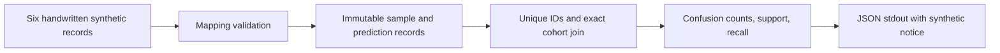

# Kiến trúc Foundation V1

Code mới hỗ trợ bản ghi trong bộ nhớ, phép đếm phân loại và CPU sensitivity
PROPOSED trên saved reports. Không import code thực nghiệm cũ. Cây có **29 file, 7 thư mục** không tính
root; `data/` local và virtual environment không thuộc inventory Git.

```text
SafeShift/
├── README.md
├── AGENTS.md
├── pyproject.toml
├── .gitignore
├── .gitattributes
├── docs/
│   ├── RESEARCH_OVERVIEW.md
│   ├── ARCHITECTURE.md
│   ├── DATA_AND_ETHICS.md
│   ├── RESULTS_AND_LIMITATIONS.md
│   ├── ROADMAP.md
│   ├── SOURCE_FEASIBILITY_GATE_20261024.md
│   ├── SOURCE_FEASIBILITY_RECEIPT_20261024.json
│   └── HISTORY.md
├── safeshift/
│   ├── __init__.py
│   ├── data/
│   │   ├── __init__.py
│   │   ├── schema.py
│   │   └── validation.py
│   ├── evaluation/
│   │   ├── __init__.py
│   │   ├── metrics.py
│   │   └── sensitivity.py
│   └── models/
│       ├── __init__.py
│       └── contracts.py
├── scripts/
│   ├── demo_cpu.py
│   └── analyze_source_sensitivity.py
└── tests/
    ├── test_smoke.py
    ├── test_schema.py
    ├── test_metrics.py
    ├── test_demo.py
    └── test_source_sensitivity.py
```

## Luồng đang hoạt động



Đường gọi cụ thể từ repository root:

```text
python -B -m scripts.demo_cpu
  main() → build_report()
    → sample_from_mapping() / prediction_from_mapping()
      → SampleRecord / PredictionRecord.__post_init__()
        → validate_identifier() / validate_safety_level()
    → validate_samples() / validate_predictions()
    → classification_metrics(samples, predictions)
      → validate_samples() / validate_predictions()
      → join exact sample_id set → confusion counts → support → recall
  → json.dumps(..., allow_nan=False) → stdout
```

Validation trong evaluation bảo vệ cả người gọi trực tiếp, ngoài demo. Không
đọc/ghi dataset hoặc tạo artifact; demo không gọi interface mô hình.

## Hợp đồng và trách nhiệm từng module

| Module | Đầu vào → đầu ra / trách nhiệm |
| --- | --- |
| `data/schema.py` | `SAFETY_LEVELS`; `SampleRecord(sample_id, true_safety_level)` và `PredictionRecord(sample_id, predicted_safety_level)` bất biến. |
| `data/validation.py` | Mapping có đúng trường bắt buộc → record; kiểm kiểu/giá trị, nhãn, ID không rỗng, trùng ID; kiểm đường dẫn portable cho model contracts. |
| `evaluation/metrics.py` | Hai iterable record → dict JSON-compatible với `n_images`, `valid_canonical_n`, `invalid_n`, `confusion_matrix`, `support`, `per_class`. |
| `models/contracts.py` | `ModelInput(sample_id, image_path, prompt)`; `ModelOutput` chứa sample/run/model/revision và tham chiếu raw/prompt/generation config; `VisionLanguageModel.generate()` là typing Protocol. |
| `scripts/demo_cpu.py` | Sáu ví dụ viết tay → báo cáo tổng hợp xác định; không dùng model giả. |
| `evaluation/sensitivity.py` | Exact join metadata/saved reports; weighted AUROC tie=0,5, components, support/undefined và đại diện exact. Chỉ **PROPOSED_EXPLORATORY**, tách khỏi classification benchmark API. |
| `scripts/analyze_source_sensitivity.py` | Receipt/ordered inference metadata bất biến tại `31a04e6`, checksum ZIP/archive/manifest/binding/result/CSV; kiểm đủ trạng thái V4 và tùy chọn thêm cohort V4-success gốc bên cạnh các cohort trước. Output ignored, không overwrite; không ảnh/annotation/raw logit payload hoặc pooling recovery. |
| `tests/` | Smoke tests giữ nguyên; schema/validation/model transport, metrics và CLI demo trên fixture tổng hợp. |
| `pyproject.toml` | Package Python 3.11+, setuptools build, không runtime dependencies; chỉ đóng gói `safeshift*`. |

`sample_id` là chuỗi định danh opaque, phải được truyền nguyên vẹn và duy nhất
trong cohort. Manifest lịch sử dùng file stem làm ID; code này không tái tạo ID
hoặc áp regex dataset lên ví dụ tổng hợp. Hai record là projection phục vụ ứng
dụng, **không phải schema gốc InspecSafe**, không định nghĩa lại split/domain/nhãn.

Nhãn phải khớp chính xác `Level01`–`Level04`. Prediction `None` là INVALID tường
minh; chuỗi `INVALID`, typo và trường prediction bị thiếu đều bị từ chối. Dự đoán
thiếu/thừa ID hoặc trùng ID làm evaluation báo lỗi thay vì bỏ hàng hoặc ghi đè.

Ma trận có hàng nhãn thật và cột `[Level01, Level02, Level03, Level04, INVALID]`.
Support là tổng hàng, gồm INVALID. Recall là ô chéo/support; support bằng 0 cho
`None` (JSON `null`). Cohort rỗng có counts bằng 0 và recall không xác định.
Không có macro averaging, loại lớp thiếu support hoặc metric ngưỡng ngầm định.

`ModelOutput` cần `sample_id`, `run_id`, `model_id`, `model_revision`,
`raw_output_path`, `prompt_path`, `generation_config_path`. Các path tính từ repo
root, dùng `/`, không absolute, drive Windows hoặc `..`. Đây là kiểm tra chuỗi,
không xác minh file tồn tại, checksum hay việc raw đã được lưu. Runner tương lai
phải lưu raw trước parse, liên kết request/response ID và lưu cả lỗi, môi trường,
source commit, input checksum, cấu hình/seed. Production decoding, prompt,
preprocessing và failure envelope chưa được định nghĩa/triển khai tại đây.

## Nguồn hợp đồng và phần chưa triển khai

| Nội dung được giữ | Nguồn tại snapshot `31a04e6` |
| --- | --- |
| Bốn nhãn canonical | [protocol/schema.py](https://github.com/tantdna2/SafeShift/blob/31a04e6f7175cca818c63b4de0153246b3f3ecdb/safeshift/protocol/schema.py) |
| Counts 4×5, support, recall, mẫu số INVALID và kiểm ID trùng | [d9r24_metrics.py, classification_metrics](https://github.com/tantdna2/SafeShift/blob/31a04e6f7175cca818c63b4de0153246b3f3ecdb/safeshift/protocol/d9r24_metrics.py#L98) |
| Join đầy đủ trước báo cáo và giữ INVALID | [ls1/evaluate.py](https://github.com/tantdna2/SafeShift/blob/31a04e6f7175cca818c63b4de0153246b3f3ecdb/safeshift/ls1/evaluate.py) |
| ID từ stem trong manifest cũ, chỉ tham khảo | [data/manifest.py](https://github.com/tantdna2/SafeShift/blob/31a04e6f7175cca818c63b4de0153246b3f3ecdb/safeshift/data/manifest.py#L233) |

[protocol/metrics.py](https://github.com/tantdna2/SafeShift/blob/31a04e6f7175cca818c63b4de0153246b3f3ecdb/safeshift/protocol/metrics.py)
là interface `NOT_IMPLEMENTED`, không đủ làm nguồn công thức. Vì vậy Foundation
chỉ tách các phép đếm được định nghĩa rõ ở D9R24/LS1, không nhận version hay tính
tương đương của toàn engine lịch sử. Strict application mapping mới cũng không
phải parser output mô hình được freeze.

Chưa triển khai: dataset loader/parser, image I/O, model backend/inference,
response parser, raw-output writer/auditor, HNLO/PA3, LS1/calibration, production AUROC,
RQ2 hazard strata, RQ3 disagreement, bootstrap/CI, grounding, threshold selection
và production benchmark harness. Một số có công thức ở lịch sử nhưng nằm ngoài
task này; metric/production contract còn pending phải chờ review thẩm quyền.

## Phát triển Seminar và Khóa luận

Weighted AUROC mới là công cụ thăm dò trên saved score, không tính lại HNLO
hoặc đổi metric chính thức. Rule `w_i=1/group_size` giữ nhãn/score mỗi ảnh;
point/family/dHash components là giả định độ nhạy, không source registry hoặc
đơn vị độc lập được xác minh. Output/receipt và cohort boundaries ở
[hồ sơ khả thi](SOURCE_FEASIBILITY_GATE_20261024.md). Không đưa phép phân tích
này vào demo tổng hợp hoặc tự thay endpoint D9R22.

Mỗi task thêm chức năng nhỏ vào module thích hợp, kèm test lỗi/biên bằng dữ liệu
tổng hợp và nguồn hợp đồng. Thêm backend khi có yêu cầu được duyệt, giữ model
transport tách khỏi parser/evaluation; không để thao tác import tải model/dữ liệu.
Giữ raw immutable ngoài Git và pipeline tái tạo được trước khi mở rộng báo cáo.
Grounding hoặc thiết kế holdout theo nhóm có thể là mở rộng Khóa luận, cần phê
duyệt khoa học, dữ liệu và quyền thực nghiệm riêng. Không thêm sẵn train.py,
notebook hay thư mục rỗng.

Tổ chức có chọn lọc theo CCDS v2: package dùng lại được, raw bất biến, dữ liệu
ngoài Git và provenance rõ. Không nhập các stub train/predict của template.
Nguồn tham khảo đã đọc ngày 24/10/2026, commit
[`17c991b0b03668f6e36503a4416202900196f501`](https://github.com/drivendataorg/cookiecutter-data-science/tree/17c991b0b03668f6e36503a4416202900196f501):
[README và cấu trúc mẫu](https://github.com/drivendataorg/cookiecutter-data-science/blob/17c991b0b03668f6e36503a4416202900196f501/README.md),
[opinions.md](https://github.com/drivendataorg/cookiecutter-data-science/blob/17c991b0b03668f6e36503a4416202900196f501/docs/docs/opinions.md).

## Định tuyến ngữ cảnh cho Codex/Antigravity

Đọc [AGENTS](../AGENTS.md), [README](../README.md), tài liệu này và
[ROADMAP](ROADMAP.md) trước task code; dùng task description làm phạm vi hiện tại.
Root `ROADMAP.md`/`TASKS.md` đã thuộc snapshot trước reset; xem [HISTORY](HISTORY.md)
nếu cần truy quyết định cũ. Main mới không có hai file root đó.

Sau đó chỉ đọc `schema.py`/`validation.py` + `test_schema.py` cho task record;
`metrics.py` + `test_metrics.py` và nguồn metric cho task đánh giá;
`contracts.py` + model contract tests cho task interface; `demo_cpu.py` +
`test_demo.py` cho task demo. Task bằng chứng đọc `RESULTS_AND_LIMITATIONS.md`
rồi đúng nguồn commit được dẫn. Không nạp toàn bộ 693 file, không phục hồi mã
cũ hàng loạt và không gọi công cụ khác để tự mở rộng thẩm quyền thực nghiệm.

## Ba VLM TRAIN pilot v1 — code PREP (27/10/2026)

Phần Foundation/inventory phía trên mô tả phạm vi nền trước task pilot. Gói mới
`safeshift/pilot/` có chức năng được Owner giao trong cùng Draft PR; chưa có
execution release hoặc kết quả thật. Không thay API/metrics Foundation hay M2.

| Module / script | Trách nhiệm |
| --- | --- |
| `pilot/contract.py`, `manifest.py` | Model/config/authority/source binding; đúng master TRAIN, selector xác định, input discovery/validation; không có dataset read khi import. |
| `pilot/backend.py` | Ba native adapters; preflight trước weights, audited Phi code, single-T4 FP16/eager; không synthetic prediction backend production. |
| `pilot/phi_attention.py`, `phi_inputs.py` | Phi 4.43.3: config eager sau deserialize, CLIP scope và reviewed-class `from_pretrained` dùng chung CPU meta/worker; tránh AutoModel re-exec reset CLIP. CPU native synthetic processor 16 crops/token/grid/mask/dtype và Hub checkpoint metadata trước ledger. Giữ strict eager; không weights/CUDA/forward tại gate CPU. |
| `pilot/diagnostics.py` | Event start/pass/failure theo stage/subcomponent, config/class cụ thể, traceback giới hạn/redacted, RAM/cgroup; giữ lỗi constructor trước khi backend object tồn tại. |
| `pilot/artifacts.py`, `hnlo.py` | Exclusive durable raw/partial archive/resume; model-specific token branch/actual decision proof, independent decoder và numeric oracle. |
| `pilot/runner.py`, `bootstrap.py` | Kernel stdlib chọn CPython Linux 3.12/3.11; tạo venv không pip, bootstrap wheel pip đã khóa hash vào đúng target, kiểm pins/CPU ABI và receipt `nvidia-smi` trước consumption; worker khóa executable/prefix, sau đó CUDA/model/first12; dừng lỗi; PILOT không promote FULL. |
| `pilot/report.py` | Exact planned-ID accounting, classification + HNLO coverage, domain/supplement tách riêng; thresholds đề xuất chưa duyệt. |
| `scripts/prepare_three_vlm_pilot.py`, `export_pilot_qwen_verified.py` | CPU preparation và optional original-V4 exporter, mỗi phần cần data/artifact grant riêng trước đọc. |
| `scripts/report_three_vlm_pilot.py`, `build_three_vlm_notebooks.py` | Hash/replay/exact join archives; reproducible embedded-source notebook generation. |
| `SafeShift_ENVIRONMENT_PREFLIGHT_{phi,smolvlm2}.ipynb` | Cùng runtime qualification production nhưng không grant/data/GPU/weights/attempt; receipt ở working, venv/cache/temp ở scratch. |

Model/data imports nặng nằm sau authorization; package/test CPU mặc định vẫn chỉ
standard library. Các công cụ public source/tokenizer audit dùng dependencies
riêng, không weights. Đọc [runbook](KAGGLE_THREE_VLM_PILOT.md),
[source/CPU audit](THREE_VLM_TECHNICAL_AUDIT.md) và `tests/test_pilot.py` trước sửa
gói này; không đọc lại toàn lịch sử hoặc chuyển grant cũ. Review/audit độc lập,
real TRAIN preparation, model access/native T4/Phi ABI, real HNLO/quality và
FULL TRAIN đều có gate riêng, hiện chưa được thực nghiệm.

Issue #143 bổ sung [nghiệm thu Phi end-to-end](PHI_KAGGLE_END_TO_END_143.md):
real-loader a4/a5 reproduction và native generation pipeline với scripted logits
CPU, không model inference. Logs lớn xuất tail có hash/coverage tường minh;
raw không truncate. Bằng chứng phần mềm không chứng minh T4 fit/HNLO thực tế.

Kaggle notebook kernel có thể là Python 3.13; nó không được dùng làm worker.
Supervisor probe candidate bằng chính tiến trình đó, yêu cầu CPython Linux x86_64
3.11/3.12 cùng module stdlib thiết yếu (`ensurepip` chỉ được quan sát), rồi tạo
`venv --without-pip --copies`. Supervisor pip hỗ trợ `--python` cài local wheel
pip 25.0.1 đã khóa URL/size/SHA vào target; worker tự kiểm version/path/prefix.
Requirements phải khớp `runtime_versions.json`; pip check/freeze và CPU native op chạy trước ledger.
Pilot còn ghi receipt `nvidia-smi` PASS trước ledger, bind receipt hash; lỗi GPU
hoặc ghi receipt giữ BLOCKED không tiêu thụ attempt. Hai notebook environment
preflight vẫn chỉ chạy CPU; CUDA FP16 thật được kiểm trong worker sau ledger.
Worker kiểm lại `sys.executable`, `sys.prefix`, version và mọi site-packages để
ngăn rò thư viện kernel. Không candidate hợp lệ thì lưu BLOCKED receipt, không
fallback 3.13 hoặc tự build/download Python.
